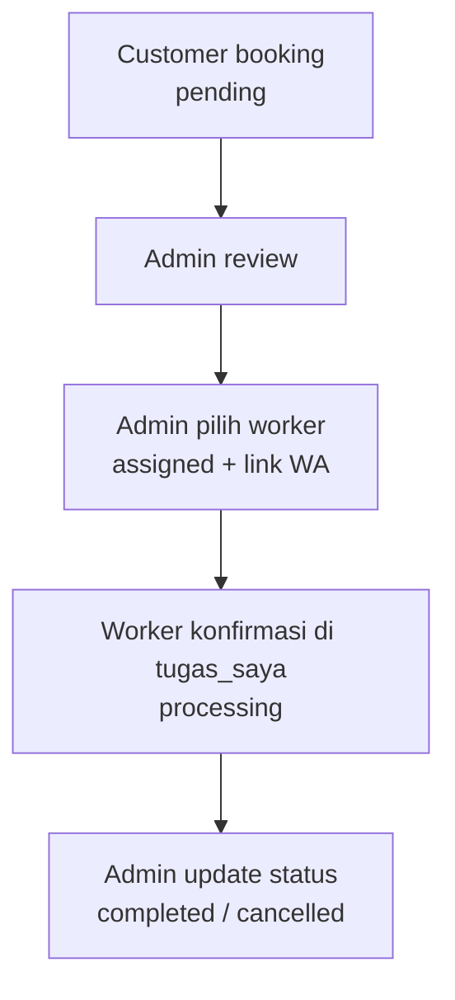

# GriyaResik

Website layanan cleaning service dengan tiga peran: customer, admin, dan worker.

## Menjalankan proyek

### 1. Persyaratan

- Node.js dan npm
- PostgreSQL / Supabase
- File `backend/.env` berisi konfigurasi database, JWT, dan Google OAuth

Contoh nama variabel ada di `backend/.env.example`. Jangan commit nilai aslinya.

### 2. Install dependency

Dari folder utama proyek:

```bash
npm install
```

### 3. Jalankan server

```bash
npm start
```

Untuk mode development dengan auto-reload:

```bash
npm run dev
```

### 4. Buka website

- Halaman depan: `http://localhost:3000`
- Health check: `http://localhost:3000/health`
- Halaman login: `http://localhost:3000/html%20dan%20css/login.html`

Folder `Frontend/` disajikan langsung oleh Express. File fisik berada di struktur baru (`pages/`, `shared/`, `assets/`), tetapi alias URL lama seperti `/html dan css/...`, `/js/...`, dan `/images/...` tetap aktif agar link lama tidak rusak.

## Struktur frontend

```text
Frontend/
  pages/                halaman aktif
  shared/
    js/                 api.js, auth.js, dan skrip aktif lain
    css/                CSS bersama
  assets/
    images/             gambar
  archive/
    prototypes/         halaman lama, bukan produksi
```

## Struktur backend

Backend sudah dipecah tanpa mengubah alamat endpoint:

```text
backend/
  server.js              entry point, menjalankan app.listen
  app.js                 middleware global + pemasangan router
  context.js             koneksi DB, auth, upload, helper, validator bersama
  db.js                  Pool PostgreSQL
  middleware/auth.js     verifyToken / verifyAdmin
  routes/                route per fitur (URL tetap /api/...)
  uploads/               foto profil (data, bukan kode)
```

Semua URL API, urutan middleware, dan bentuk response dipertahankan sama seperti sebelum pemecahan.

## Base URL API

Semua frontend memakai satu file `Frontend/shared/js/api.js`. Secara default base URL mengikuti origin halaman, sehingga cukup menjalankan satu server di `http://localhost:3000`. Untuk backend di alamat lain, set sebelum `api.js` dimuat:

```html
<script>window.GRIYA_API_BASE = "https://alamat-backend";</script>
<script src="../js/api.js"></script>
```

## Alur booking



Status `assigned` berarti worker sudah dipilih tetapi belum dikonfirmasi. WhatsApp dipakai sebagai notifikasi berupa link `wa.me`, bukan pengiriman otomatis.

Customer bisa memulai booking dari dua jalur:

- `Layanan.html`: pilih ruangan dan paket, lalu lanjut ke `booking.html` bersama `service_id`.
- `booking.html`: dibuka langsung, lalu mengambil daftar layanan dari `GET /api/services` dan memilih layanan di halaman tersebut.

Add-on diambil dari `GET /api/addons` lalu difilter sesuai layanan yang sedang dipilih. Ruangan Kustom sudah dihapus dari alur aktif. Karena form belum menyediakan jumlah ruangan, backend menyimpan `room_count = 1`; `place_type` yang kosong disimpan sebagai `Lainnya`.

## Kondisi fitur saat ini

Sudah terhubung ke database:

- register/login email, JWT, bcrypt
- login Google (kode verifikasi ada; perlu ditinjau keamanan account linking)
- Client ID Google dibaca frontend dari `GET /api/config`; `config.js` hanya menyimpan fallback publik
- katalog layanan dan add-on
- CRUD admin untuk customer, worker, layanan, add-on
- profil customer dan upload foto
- pembuatan booking beserta payment row
- pembacaan booking customer/admin/worker
- penugasan worker oleh admin, disusul konfirmasi oleh worker
- perubahan status booking oleh admin
- pengecekan status booking customer lewat API

Masih prototipe / belum terintegrasi penuh:

- verifikasi pembayaran otomatis
- dashboard laporan dan pengaturan
- jadwal dan riwayat worker
- pengiriman WhatsApp otomatis ke worker (link `wa.me` tersedia setelah penugasan)

## Catatan

Belum ada file schema atau migration database. Struktur database yang diketahui saat ini hanya berasal dari query di folder `backend/routes/`.
